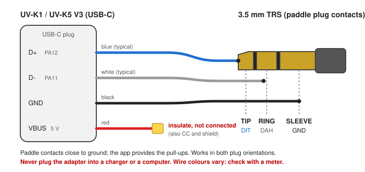

# CW USB overlay app

`CW USB` is the USB-C-input variant of CW Keyer. It transmits a manually
keyed A1A-style carrier on the current TX VFO and is entirely contained in its
own 4 KiB overlay. The implementation is shared with `CW Keyer`, but this
binary contains only the USB-C paddle input path.

## Requirements and install

- F4HWN Fusion firmware with overlay ABI 1 and API level 3.
- Build: `./compile-app.sh cwusb` from the repository root, output
  `build/Apps/CWUSB.app`; install it in a free slot with UV Studio.
- The VFO must be in FM. The transmitted signal is an unmodulated carrier, so
  the other station needs a CW or SSB receiver to hear a tone.

## Migrating from CW Keyer 1.0

The recommended upgrade is to keep or update CW Keyer in its current slot and
install CW USB in a free slot. CW Keyer keeps its existing settings because its
name is unchanged.

Settings are stored in the configuration area of the slot where the app is
installed, tagged with the name of the app that saved them. CW USB therefore
starts with defaults, even when it is installed in the former CW Keyer slot:
the configuration left there is tagged `CW Keyer`, so CW USB ignores it.
Configure CW USB once: use the same `XTAL` correction as CW Keyer and
CW Decode, then set its WPM, tone, break-in, mode, contact order and speaker
preference.

## Controls

- `PTT`: straight-key carrier in every mode.
- USB-C D+ (tip): straight key in `STRAIGHT`, dit in `PADDLE`.
- USB-C D- (ring): dah in `PADDLE`.
- `1`: toggle `STRAIGHT` / `PADDLE`.
- `0`: enable or mute the CW receive audio path.
- `2`: raise the keyer speed (5 to 60 WPM).
- `3`: raise the receive CW tone by 50 Hz.
- `4`: raise the semi-break-in delay by 50 ms.
- `5`: swap the dit and dah contacts.
- `6`: raise the crystal correction by one BK4829 `REG_3B` step.
- `F`, then `2`, `3`, `4` or `6`: lower the corresponding setting.
- `UP` / `DOWN`: tune locally in 100 Hz steps, up to +/-50 kHz.
- `MENU`: show or close the help page.
- `EXIT`: leave the app.

## USB-C paddle adapter

Wire a USB-C plug to a 3.5 mm stereo jack as follows:

| USB-C line | MCU pin | Jack | Function |
|---|---|---|---|
| D+ | PA12 | tip | dit or straight key |
| D- | PA11 | ring | dah |
| GND | - | sleeve | common |
| VBUS, CC, shield | - | insulated, not connected | - |

Contacts close to ground; the app supplies the pull-ups. The adapter works in
both USB-C plug orientations. A mono plug can be used only in `STRAIGHT`, where
the ring is ignored. In `PADDLE`, its ring-to-sleeve short holds the ring
contact closed permanently: dah in `DI-DA`, dit in `DA-DI`.

Never plug this adapter into a charger or computer: a charger energizes VBUS,
and a computer host can also drive or bias D+/D-. The app temporarily
configures PA11/PA12 as inputs and stops the USB clock (a powered USB device
holds D+ for about two seconds after a contact closes), then restores the saved
register bits on exit. There is no PC link while the app is open.

A USB contact change must read the same on five consecutive polls, about 5 ms,
before a straight-key edge or keyer start is accepted.

The USB variant can sample both contacts together, so a squeeze alternates
dits and dahs. The keyer has automatic repeat and no paddle memory. The common
RF keying, CW receive, timing, sidetone and protection behavior is documented
in the sibling [`CW Keyer` README](../cwkeyer/README.md).

## Validation and known USB-C limit

- The USB input path in the original combined CW Keyer was tested on a UV-K1
  (Labs v6.2.0) with a straight key and paddle in both plug orientations. The
  PC link returned after exit, and no false elements appeared with the paddle
  lead close to the antenna at high power into a dummy load. The original
  implementation and test record are in
  [PR #665](https://github.com/armel/uv-k1-k5v3-firmware-custom/pull/665).
- The separate CW USB binary still requires validation on the radio.
- After about 0.5 s without contact, the radio's USB-C path reports a closing
  contact as closed for only 3 to 10 ms, then as open for about 150 to 220 ms
  while it is still held, before it follows the contact again. When that first
  closed reading is shorter than the contact debounce (about 5 ms), the first
  element starts roughly 200 ms late. The debounce timing implies a second
  case, not yet observed on the radio: a longer first reading starts the
  keying at once, then the contact reads open. In `STRAIGHT`, a short carrier
  is then followed by about 200 ms of silence before the intended mark; in
  `PADDLE`, a held paddle can stop after the first element until the window
  ends. The measurements and investigation are tracked in
  [issue #683](https://github.com/armel/uv-k1-k5v3-firmware-custom/issues/683).
- The K-plug line PA10 is not used as a paddle input: it follows the PTT
  button on the bench.

## Contributing

CW USB has no keyer source of its own: `cwusb_app.c` sets `CW_KEYER_USB` to 1
and includes [`../cwkeyer/cwkeyer_app.c`](../cwkeyer/cwkeyer_app.c). The
keyer, CW receive, display, settings and RF keying are shared with CW Keyer.

- Any change outside an `#if CW_KEYER_USB` block also changes CW Keyer.
  Behavior that only concerns the USB-C input (contact sampling, debounce or
  start rules, an arming step, port setup) goes under `#if CW_KEYER_USB`,
  preferably in USB-only functions called from the shared loop rather than as
  conditionals scattered through shared functions.
- A change that benefits both apps stays in the shared code and must be tested
  in both: SIDE and PTT keying in CW Keyer, USB-C and PTT keying in CW USB.
- USB-only texts go in [`../cwkeyer/gen_assets.py`](../cwkeyer/gen_assets.py)
  behind `USB_VARIANT`; each app gets its own generated asset offsets.
- `config_t` is shared. Its last byte, `reservedPort`, is always saved as 0 by
  version 1.1, so it can hold one USB-only setting whose default is 0 without
  changing `CFG_MAGIC`; validate it in `loadConfig` like the other fields.
  Changing the `config_t` layout or `CFG_MAGIC` resets the settings of both
  apps.
- Each app has its own `APP_VER` in its `build.sh`: a USB-only change bumps
  CW USB, a shared change bumps both.
- Build both apps after every change to the shared source:
  `./compile-app.sh cwkeyer cwusb`. Each build fails if its binary exceeds
  the 4 KiB overlay.

## Credits

- CW USB application, USB-C paddle port, paddle keyer and contact debounce:
  Johan Denoyer F4WAT ([@jdenoy](https://github.com/jdenoy)).
- Original CW Keyer base: Armel F4HWN
  ([@armel](https://github.com/armel)).
- USB-C wiring based on KI6CR's CW adapter for the UV-K5 V3.
- TX sidetone approach: NR7Y's CW implementation.
